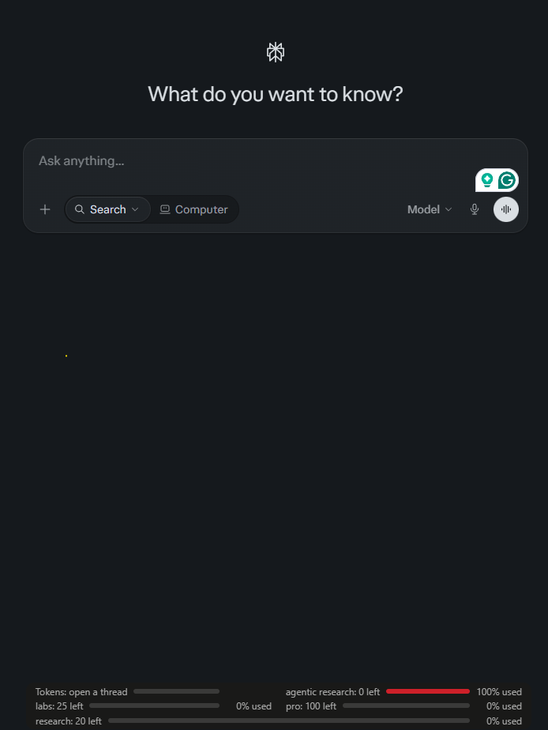

# Perplexity Counter

A small browser extension that adds a usage strip to [perplexity.ai](https://www.perplexity.ai): an approximate token count for the current thread, plus how many Pro, Research, Labs and agentic queries you have left.

## Features

- **Token count**: approximate tokens used in the current thread, with tokens left against an assumed context limit and a progress bar.
- **Query bars**: remaining Pro, Research, Labs and agentic research queries, read from your own account.
- **Auto refresh**: updates after each answer finishes, and every 60 seconds.
- **Theme aware**: follows light and dark mode.

## Installation

Works on Chrome, Brave, Edge and other Chromium browsers.

1. Download the latest zip from the [Releases](../../releases) page and extract it.
2. Open the extensions page (`chrome://extensions` or `brave://extensions`) and turn on **Developer mode**.
3. Click **Load unpacked** and select the extracted folder that directly contains `manifest.json`.
4. Refresh any open perplexity.ai tab.

The folder picker shows only folders, not files. That is normal, so you will not see `manifest.json` in it.

## How it works

- Counts tokens from the visible text of the thread page using the `o200k_base` tokenizer (via [gpt-tokenizer](https://github.com/niieani/gpt-tokenizer)).
- Reads `/rest/rate-limit/all` on perplexity.ai with your existing session to get remaining query counts.
- Watches answer streams to know when to refresh.

## Limitations

- **Token count is approximate.** It counts text visible on the page, not what Perplexity actually sends to the model, and the tokenizer is OpenAI's, not the one your model uses.
- **The context limit is an assumption.** Perplexity does not publish one limit, so `CONTEXT_LIMIT_TOKENS` in `src/content.js` is set to 128,000. Edit it if you know your model's real limit.
- **Query bars use the highest remaining value the extension has seen as the full amount**, because the endpoint reports remaining counts only. Bars become accurate after you have used some queries.
- **It depends on an undocumented endpoint.** If Perplexity changes it, the query bars may stop working.

## Privacy

- No data leaves your browser. There are no external servers and no tracking.
- Requests go only to `www.perplexity.ai`, using your existing session.
- Nothing is stored except a small value in the site's local storage to remember the highest remaining counts.

## Disclaimer

This is an unofficial project. It is not affiliated with or endorsed by Perplexity AI or Anthropic.

## Credits

- Token counting via [gpt-tokenizer](https://github.com/niieani/gpt-tokenizer) (MIT). See [THIRD_PARTY_NOTICES.md](./THIRD_PARTY_NOTICES.md).
- Inspired by Claude Counter, a similar extension for claude.ai.

## License

MIT. See [LICENSE](./LICENSE).
